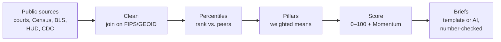

# Methods

FindARoofNC turns public data on evictions, foreclosures, housing costs, jobs and structural vulnerability into a 0–100 **Risk Score** for each of North Carolina's 100 counties, and for census tracts in Durham County. Every indicator is ranked against its peers (counties against counties, Durham tracts against Durham tracts), grouped into five pillars, and combined with fixed weights. The score is **relative**: a county with a score of 80 shows more signs of housing-loss pressure than most other NC counties, not a fixed amount of risk. FindARoofNC shows where housing-loss pressure is building. It does not identify individuals and does not predict whether any specific household will become homeless.

> This file is the source of the Methods section on the website's About page. Lines like `{{acs_year}}` and `<!-- table:... -->` are filled in from the pipeline's output when the site is built, so the numbers on the page always match the data.

## How the pipeline works

All of this runs in Python on a laptop. The website only re-weights the five pillar scores when someone moves a slider.

## Pillars and weights

<!-- table:weights -->

Inside a pillar, each indicator's weight is shared out over the indicators that have data. If a pillar has no data at all, it's left out and the other pillars' weights are scaled up to fill the gap. Weight that can't be used is reported as **coverage** (for example, 80% means 80 of the 100 weight points had data).

Not available in this build: {{missing_optional}}.

## Indicator formulas

Every indicator is oriented so that **higher = more pressure**.

| Indicator | Formula |
|---|---|
| Eviction filings | Summary ejectment filings in the latest complete fiscal year ({{data_as_of.evictions}}) ÷ renter-occupied homes × 100 |
| Change in eviction filings | Eviction rate in the latest fiscal year − eviction rate the year before |
| Foreclosure filings | Foreclosure filings in the last 12 months with data (through {{data_as_of.foreclosures}}) ÷ owner-occupied homes × 1,000 |
| Renters paying 50%+ of income on rent | Renter households paying 50% or more ÷ renter households where it could be computed × 100 (ACS {{acs_year}}) |
| Housing wage gap | Yearly rent for a 2-bedroom at HUD's Fair Market Rent ÷ 0.30, divided by the median income of renter households. Above 1 means the typical renter can't afford a 2-bedroom at 30% of income |
| Unemployment rate | Latest monthly county rate from BLS ({{data_as_of.unemployment}}) |
| Change in unemployment | Latest month − the same month a year earlier (county rates aren't seasonally adjusted, so like months are compared) |
| Poverty rate | People below the poverty line ÷ people for whom poverty is determined × 100 |
| Households that rent | Renter-occupied ÷ all occupied homes × 100 |
| SVI household characteristics | CDC/ATSDR Social Vulnerability Index theme 2, ranked within NC, × 100 |
| SVI housing type & transportation | SVI theme 4, ranked within NC, × 100 |
| Change in foreclosure filings (Momentum only) | Last 3 months of filings − the same 3 months a year earlier, ÷ owner-occupied homes × 1,000 |

**Eviction filings** are court issues with code `SUME` ("Summary Ejectment"), counted across all case types. Writs of possession (`WRIT`) are left out because they are a later step in the same cases and would double-count them.

**Durham tracts** use the same framework with the indicators available at tract level: eviction filings (Durham Neighborhood Compass, {{data_as_of.durham_evictions}}), renters paying 50%+ of income on rent, unemployment rate (ACS: unemployed ÷ labor force), poverty rate, households that rent, and the two SVI themes.

## How the score is computed

1. **Percentile:** each indicator is ranked among all units that have a value (0–100; the highest value gets 100). Percentile ranks aren't thrown off by extreme values, so nothing is capped.
2. **Pillar score:** the weighted mean of the available indicator percentiles in the pillar.
3. **Risk Score:** the weighted mean of the pillar scores, over the pillars that have data.
4. **Momentum** (counties only): the weighted mean of the percentiles of the change indicators: unemployment change 35, eviction change 25, foreclosure change 20, 211 change 20 (re-weighted over what's available).
5. **Top drivers:** each indicator's share of the score. The three largest are shown as sentences built from a template, not by AI. Contributions are divided by the weight of the pillars that have data, so they add up exactly to the score.

## Tiers

<!-- table:tiers -->

Scores are relative: the legend always says whether the comparison is with all 100 NC counties or with other Durham County tracts. The top tier is called **Priority**.

## Flags

- **Rising:** Momentum 75 or higher **and** score 40 or higher. The score condition stops a low-pressure county that moved a little from being flagged.
- **Low reliability:** population under 10,000. Rates in small counties swing a lot from year to year, so they get a badge instead of being hidden. This build: {{low_reliability_counties}}. Every Durham tract is under 10,000 people by design, so this badge isn't used for tracts.
- **Partial data:** coverage under 70%. Durham tracts can reach at most 52% coverage, because there is no tract-level foreclosure, eviction-change, housing-wage-gap, unemployment-change or 211 data. Every scored tract therefore carries this badge.

## What's left out, and why

- **SVI theme 1 (socioeconomic status)** is excluded because it repeats poverty, unemployment and housing cost burden, which are already in the index. Including it would count them twice.
- **SVI theme 3 (racial and ethnic minority status)** is excluded on principle: **race is not a risk input.**
- No data about individual people is used anywhere. Every number is an aggregate for a county or a census tract.

## Missing data

- **Never filled in.** Missing values stay missing. They are never replaced with zeros, averages or estimates.
- **Optional sources** (NC 211 requests, Zillow rents, and the two validation sources) may be absent. Their weight is shared among the other indicators, and the site says so.
- **October 2025 unemployment:** BLS published no county estimates for October 2025 ("Data unavailable due to the 2025 lapse in appropriations"). That month is left blank, and the sparkline shows a gap.
- **Durham tracts with no households:** Tracts 15.01 and 15.03 (Duke's campus) have residents but no households, because everyone lives in group quarters such as dorms. Tract 98.01 has no residents. The index measures pressure on households, so these tracts are not scored and show as "No data". Without this rule, Tract 15.03 would rank first in Durham on a single indicator (student unemployment).

## Geography notes

- Counties are joined by 5-digit FIPS code and tracts by 11-digit GEOID, never by name. The one exception is court files, which only list county names. One helper matches them to FIPS codes and checks that all 100 counties match exactly once.
- ACS ({{acs_year}}) and SVI 2022 use the **2020** census tracts (68 in Durham County).
- The Durham Neighborhood Compass eviction counts use **2010** geography: 60 tracts and 153 block groups. In the input check, only 52 of its 60 tract IDs matched a 2020 tract (87%), below the 95% needed to join directly. So each 2010 block group's count is split across the 2020 tracts it overlaps, in proportion to shared land area, using the Census Bureau's 2020↔2010 block group relationship file. As a check, the tracts that kept their 2010 ID come out within 0.4 filings of the Compass's own tract counts on average. Tracts that were split in 2020 are estimates.
- Map shapes are the Census Bureau's 2020 cartographic boundary files, simplified for the web.

## AI briefs

- Each county and scored Durham tract can have a short brief written by Claude from a small set of computed facts: name, score, tier, rank, Momentum, Rising flag, the three driver sentences, pillar scores and the latest unemployment change. No raw data or personal information is sent.
- **Actions are chosen in Python**, from a fixed playbook keyed to the highest-scoring pillar. The model only writes one sentence on why each action fits.
- **Number check:** every number in a brief must appear in that unit's facts (allowing rounding to 0 or 1 decimal places, with or without "%"). The action keys must match exactly. A brief that fails is retried up to 2 times, then replaced by a template brief built only from the facts.
- The reply must match a fixed JSON shape (structured outputs). The original plan used temperature 0.2, but the Claude API no longer accepts sampling settings such as temperature (since 2026-10-21). Consistency comes from the fixed prompt, the JSON shape and the number check instead.
- **Template briefs**, built only from the facts, are used when the API isn't available. Only briefs written by the API carry the "AI-generated brief" label.
- The prompt is in `pipeline/prompts/brief_prompt.txt`.

## Validation

- **Weight stability:** each pillar weight is multiplied by a random factor between 0.9 and 1.1, over 500 runs with a fixed random seed. {{stability_sentence}}
- **Correlations** with independent homelessness data are described only with the words weak (|ρ| < 0.2), modest (0.2–0.4), moderate (0.4–0.6) or strong (above 0.6).

## Sources

<!-- table:sources -->

## Known limitations

- **Court data is yearly.** Eviction filings come as fiscal-year totals, so the eviction rate changes once a year. Foreclosures are monthly but published with a lag.
- **Durham's neighborhood eviction data is older** ({{data_as_of.durham_evictions}}) than the county court data, and uses 2010 boundaries (see Geography notes).
- **Validation geography doesn't match.** School districts and homelessness Continuums of Care don't line up with county borders, so those comparisons are rough.
- **Small counties** have noisy rates. Watch the Low reliability badge.
- **Scores are relative.** A low score means less pressure than other NC counties, not no pressure.
- **211 calls reflect help-seeking,** which also depends on whether people know about 211 and can reach it, not only on need.
- **Briefs** are generated from the numbers and checked automatically, but should still be read critically before acting on them.
