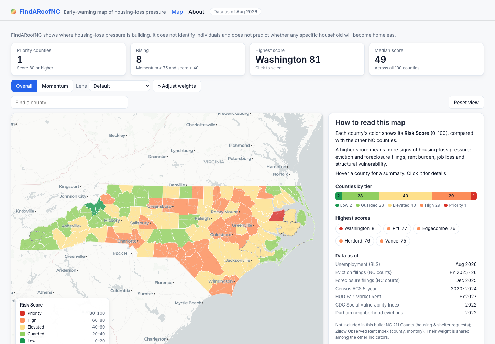
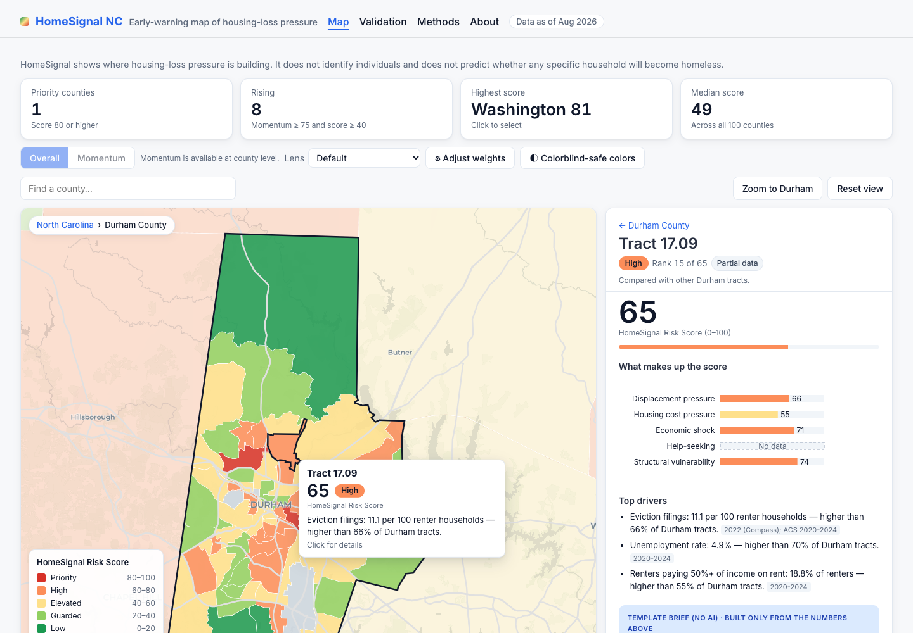

# FindARoofNC

**An early-warning map of housing-loss pressure across North Carolina's 100 counties, with a neighborhood-level view of Durham County.**

> FindARoofNC shows where housing-loss pressure is building. It does not identify individuals and does not predict whether any specific household will become homeless.





## The problem, and who it's for

Eviction prevention, rental assistance and outreach work best **before** a household loses its home. County social services departments and local governments have limited staff and money, so they need to know where pressure is building. FindARoofNC combines public data on evictions, foreclosures, housing costs, jobs and structural vulnerability into one relative score per county (and per Durham census tract). It explains what drives each score and flags where pressure is **rising**.

## How it works

Every indicator is ranked against its peers (0–100, higher = more pressure), grouped into four pillars, and combined with adjustable weights (each pillar's share is its weight out of 85):

- **A. Displacement pressure (weight 30, ≈35%)**: eviction filings, foreclosure filings, and the change in eviction filings.
- **B. Housing cost pressure (weight 25, ≈29%)**: renters paying 50%+ of income on rent, and the housing wage gap (2-bedroom rent vs. typical renter income).
- **C. Economic shock (weight 20, ≈24%)**: unemployment rate and its change from a year earlier.
- **D. Structural vulnerability (weight 10, ≈12%)**: poverty rate, share of households that rent, and two CDC Social Vulnerability Index themes. Race is deliberately **not** an input.

A fifth pillar, *Help-seeking* (NC 211 calls for housing help), was planned but removed because that data wasn't available.

A separate **Momentum** score, built from the change indicators, flags counties where pressure is rising. Full details: [METHODS.md](METHODS.md), or the Methods section of the site's About page.

## What's on the site

- **Map:** a statewide choropleth with tooltips and a detail panel. The panel has pillar bars, top drivers, a 24-month unemployment trend, a brief and every indicator. Clicking Durham County (on the map, in the watchlist or through search) opens a census-tract drill-down. There's also a sortable priority watchlist and keyboard-accessible county search.
- **Controls:** Overall/Momentum switch, pillar-weight sliders with preset lenses, Reset view, and CSV downloads of the scores under the current weights.
- **About** page: purpose, ethics, and the Methods (formulas, weights, tiers, sources and limitations).

## How to run it

You need Python 3.12 and Node 20+.

```bash
# 1. Python environment (uv shown; `python3.12 -m venv .venv` works too)
uv venv --python 3.12 .venv
uv pip install --python .venv/bin/python -r requirements.txt

# 2. API keys: copy the template and fill in CENSUS_API_KEY, BLS_API_KEY (and GEMINI_API_KEY for AI briefs)
cp .env.example .env

# 3. Hand-downloaded files: follow pipeline/manual/README.md, then check them
.venv/bin/python pipeline/00_check_raw.py

# 4. Run the whole pipeline (writes the JSON the site reads into site/src/data/)
.venv/bin/python pipeline/run_all.py
#    no Gemini key yet? use template briefs instead:
.venv/bin/python pipeline/run_all.py --template-briefs

# 5. Tests
.venv/bin/python -m pytest

# 6. The website
cd site && npm install && npm run dev      # local preview
npm run build                              # static site in site/dist/
```

**Deploying:** push to the `main` branch of a GitHub repository and set *Settings → Pages → Source* to **GitHub Actions**. The workflow in `.github/workflows/deploy.yml` only runs `npm ci && npm run build`. The Python pipeline runs locally, and its outputs are committed in `site/src/data/`.

## AI disclosure

- **Code** was written with Claude Code under the student's direction. The student reviewed and tested it.
- **Briefs** are written with Google's Gemini API (`gemini-3.8-flash` by default) from computed numbers only. The prevention actions come from a fixed list chosen by the code, and every number in a brief is checked automatically against the facts; a brief that fails is retried, then replaced by a template built only from the numbers. AI-written briefs carry an "AI-generated brief" label on the site.
- **The prompt** is in [`pipeline/prompts/brief_prompt.txt`](pipeline/prompts/brief_prompt.txt).

## Quality checks

- 220 automated tests (`pytest`) cover the data formats, ID formats, score math, parity between the Python and browser score formulas, map file sizes and coordinates, and the brief number check.
- Lighthouse 13.5 scores 100 for Accessibility, Best Practices and SEO on both pages (Map and About). On desktop, the map page is interactive in about 1.2 s with about 850 KB transferred.

## Limitations

- Court eviction data is yearly; foreclosure data lags by a few months.
- Durham's neighborhood eviction data is from 2022 and uses 2010 boundaries; it is crosswalked to 2020 tracts (see Methods).
- Small counties have noisy rates; they carry a "Low reliability" badge.
- Scores are **relative** to other NC counties (or Durham tracts), not absolute levels of risk.
- There is no help-seeking data (NC 211 calls), which could give earlier warning.
- The optional Zillow rent source and both validation sources (student homelessness, HUD Point-in-Time counts) are not in this build.

## Roadmap

Not built yet: county comparison, congressional district overlay, print to PDF, backtesting against past years, a 60-day outlook, shelter capacity gap, Hurricane Helene recovery overlay, a Spanish version, a local resource directory, live chat, and automatic data refresh.

## Data sources and credits

- **U.S. Census Bureau:** American Community Survey 5-year estimates; 2020 cartographic boundaries; 2020↔2010 block group relationship file
- **U.S. Bureau of Labor Statistics:** Local Area Unemployment Statistics
- **U.S. Dept. of Housing and Urban Development:** Fair Market Rents (FY2027)
- **North Carolina Judicial Branch:** Civil Issue Filings/Order Results; Foreclosure Filings
- **CDC/ATSDR:** Social Vulnerability Index 2022 (North Carolina)
- **DataWorks NC:** Durham Neighborhood Compass (summary ejectment counts)
- **Basemap:** © OpenStreetMap contributors © CARTO

The exact data years and links are on the site's Methods page, generated from `site/src/data/sources.json`.
